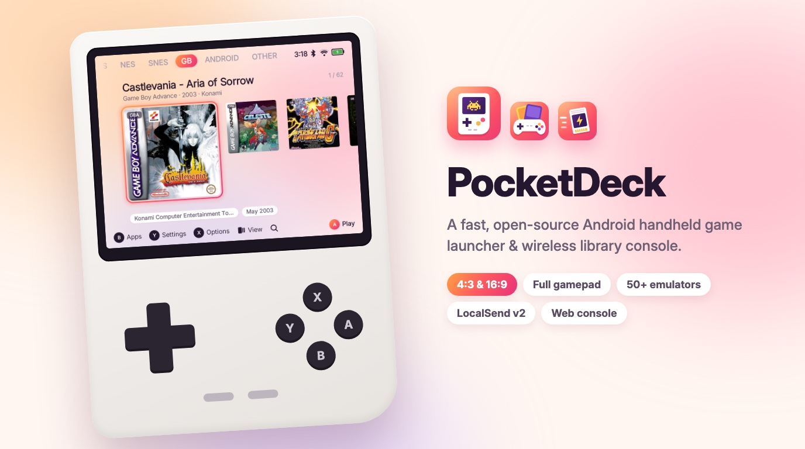
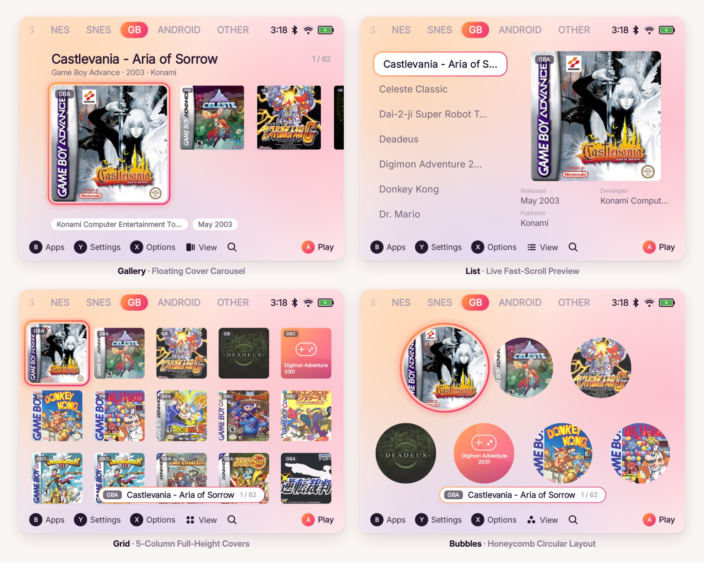
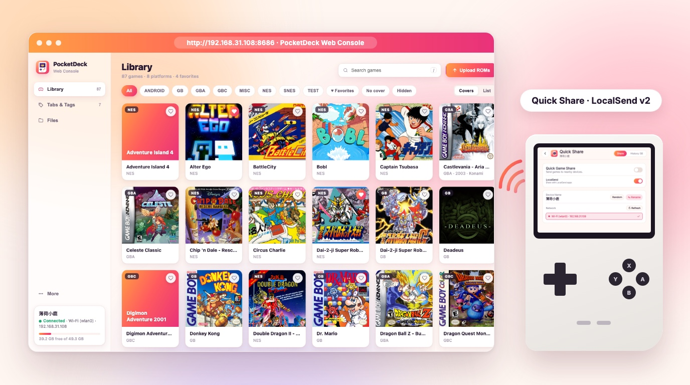
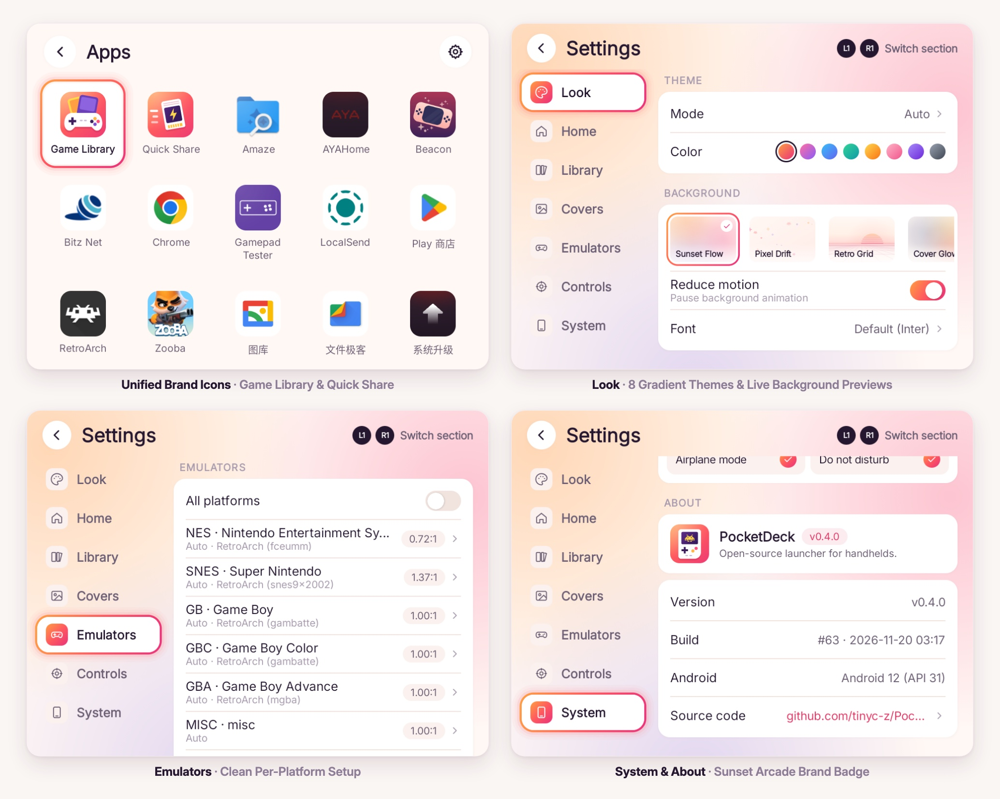

<div align="center">

# 🎮 PocketDeck

**A Lightweight, Fluid, Open-Source Android Handheld Game Launcher & Wireless Library Console**

[English](README.md) · [简体中文](README_ZH.md)

[-3DDC84?style=flat-square&logo=android&logoColor=white)](https://github.com/tinyc-z/PocketDeck)
[](#android-11-compatibility)
[](https://github.com/tinyc-z/PocketDeck)
[](#quick-share--localsend-compatibility)

<br/>



*Designed & tuned for 4:3 pocket handhelds like **KONKR Pocket Block**, as well as 16:9 Android gaming handhelds.*

</div>

---

## ✨ Why PocketDeck?

PocketDeck is crafted from the ground up with **Jetpack Compose**, zero heavy DI frameworks, custom `graphicsLayer` + `drawWithCache` zero-GC animations, binary disk index caching with first-tab-first progressive scanning, and a flat minimalist design language—delivering instant cold starts even on 10,000+ ROM libraries, silky 60+ fps scrolling, full controller navigation, and a tiny ~2.8 MB release APK.

### 🖼️ Four View Modes — Maximized for Small Handheld Screens

<div align="center">
  
</div>

- **Gallery**: Borderless floating cover carousel with spring elevation, Liquid-Glass favorite badge, and live metadata (Release Date, Genre, Developer, Publisher, File Size).
- **List**: Smooth console-style title list paired with a live-updating box-art preview (instant memory/disk cache display even during rapid D-pad scrolling) and two-column metadata card.
- **Grid**: 5-column full-height borderless cover grid with a **hairline-bordered floating title pill** (automatically flips top/bottom to never block the focused game or waste a single grid row).
- **Bubbles**: Circular honeycomb layout (3-4-3-4) with elastic focus scaling, bottom-centered Liquid-Glass favorite badge, and floating title pill for maximum viewport density on compact 4:3 screens.

---

### 🌐 PocketDeck Web Console — Sunset Arcade Library Manager

<div align="center">
  
</div>

Turn any PC, Mac, or tablet browser on your LAN into a full **Web Game Library Console** (`http://<handheld-ip>:8686`) secured with a dynamic 4-digit PIN and brute-force rate limiting:

- **Sunset Arcade UI & Live Theme Sync**: Frosted sidebar, bottom device & storage card, pill filter chips, right-hand detail drawer, and brand-gradient placeholders that automatically mirror your handheld's **Light / Dark mode** and **8 Dual-Tone Gradient Themes** in real time.
- **100% Handheld-Served Covers & Metadata**: Displays box art and full metadata served directly from the handheld (the browser never connects to external internet domains). Need an update? Trigger scraping on the handheld right from the browser modal, watch live floating scrape logs, or upload custom cover art.
- **Visual Tag & Category Editor**: Drag-and-drop reordering, editing `NOW / FAVS / OTHER` aliases & sort orders, binding platforms to custom categories, and syncing directly to the handheld with strict server-side schema & bounds validation.
- **Complete File & Archive Manager**: Clickable breadcrumbs, multi-select batch Move / Copy / Delete / Compress to ZIP, folder drag-and-drop upload (`webkitdirectory`), archive inspection & extraction (ZIP / 7Z / RAR / TAR), image/audio previews, and inline text/config editing.

---

### ⚡ Quick Share with Native LocalSend v2 Compatibility

- **Dual-Protocol Discovery & Transfer**: Works seamlessly with both **PocketDeck Quick Share** (`53318/53319`) and **LocalSend v2** (`53317` HTTPS/TLS + UDP multicast) — send ROMs or folders directly from Windows, macOS, Linux, iOS, or Android LocalSend apps!
- **Toggleable Anytime**: LocalSend compatibility is **enabled by default** and can be toggled on/off anytime inside the Quick Share screen or LAN Control panel.
- **Physical NIC Binding**: Automatically filters out VPN/TUN interfaces (`Clash`, `Tailscale`, `WireGuard`, etc.) and supports choosing specific Wi-Fi, Hotspot, or USB-LAN adapters.
- **Dedicated Inbox & Jump-to-Folder History**: Incoming files save by default to `Download/PocketDeck` (customizable per transfer before accepting), monitor live speed & progress with instant cancellation, and let you open or jump straight to the saved folder in File Manager from transfer history.

---

### 🎨 Personalization, Scraping, Performance & Emulators

<div align="center">
  
</div>

- **8 Dual-Tone Gradient Themes & 7 Backgrounds**: Curated Sunset Arcade gradient themes (`Sunset`, `Berry`, `Ocean`, `Mint`, `Lemon`, `Sakura`, `Grape`, `Graphite`), paired with live-previewed `Sunset Flow`, `Pixel Drift`, `Retro Grid`, `Cover Glow`, `Aurora`, `Custom Image`, and `Solid` backgrounds in full Light / Dark / Auto mode, plus a `Reduce motion` toggle.
- **Unified Gaming Icons & 7-Section Settings**: Matching sunset-coral brand icons across the App Launcher, Game Library, and Quick Share; full Lucide-style vector icon set; L1/R1 section switching across `Look · Home · Library · Covers · Emulators · Controls · System`; grouped white cards; and inline visual pickers.
- **Custom Fonts & Tactile Dual-Tone Key Sounds**: Import `.ttf / .otf / .ttc` fonts and enjoy a single Key Sound toggle with **Mechanical Switch** audio on category switches and **Crisp Tick** on navigation/taps.
- **Massive-Library Cold-Start Architecture**: Binary disk index cache (`Stale-While-Revalidate`) for near-instant cold boots, first-tab-first progressive ROM scanning on uncached drives, and bounded LRU tab caching for 30+ categories.
- **Multi-Source Cover & Metadata Scraping + Live Logs**: Drag-to-reorder priority across **Libretro Thumbnails / DB**, **Hasheous (CRC32)**, **ArcadeItalia**, **Wikidata**, **ScreenScraper.fr**, **TheGamesDB**, and **IGDB**, with built-in searchable & exportable scraping logs.
- **50+ Emulators & Custom Launchers**: Built-in support for **RetroArch** (auto or custom core), **PPSSPP**, **DuckStation**, **DraStic**, **melonDS**, **Dolphin**, **AetherSX2 / NetherSX2**, **Citra / Azahar**, **Yuzu / Eden / Citron**, **Cemu**, **Vita3K**, **Flycast**, **mGBA**, **Winlator**, **RPCSX**, and custom Android app intent presets.
- **Full Gamepad Control**: 60fps D-Pad fast-scroll navigation, `L1/R1` tab switching, `Swap ABXY` (Nintendo ↔ Xbox), custom key remapping with conflict resolution, and Home Launcher (`HOME`) integration.

---

## 🛠️ Setup, Configuration & Usage

### 1. ROM Folder Structure

Place your ROMs in a root directory (e.g. `/sdcard/ROMs/` or `/sdcard/PocketGames/roms/` or external SD card) with one subfolder per platform:

```text
ROMs/
├── nes/        # Nintendo Entertainment System (alias: fc, famicom)
├── snes/       # Super Nintendo (alias: sfc, superfamicom)
├── gb/         # Game Boy
├── gbc/        # Game Boy Color
├── gba/        # Game Boy Advance
├── nds/        # Nintendo DS
├── psx/        # PlayStation (alias: ps1)
├── psp/        # PlayStation Portable
├── megadrive/  # Sega Mega Drive / Genesis (alias: md)
└── arcade/     # Arcade / FBNeo / MAME
```

You can add multiple ROM folders (internal storage + TF/SD card) in **Settings → Library**.

### 2. Android 11+ Compatibility

PocketDeck targets **Android 8.0 (API 26)** up to **Android 16 (API 36)** with full **Android 11 (API 30)** compatibility:
- **All Files Access (`MANAGE_EXTERNAL_STORAGE`)**: On Android 11+, grant file access when prompted so PocketDeck can scan ROM directories and manage files across internal & external SD storage.
- **Scoped Storage & FileProvider**: Standalone emulator launches (`PPSSPP`, `DraStic`, `Flycast`, `mGBA`, etc.) use `content://` `FileProvider` URIs with `FLAG_GRANT_READ_URI_PERMISSION`, avoiding `FileUriExposedException` on Android 11+.
- **Package Visibility (`<queries>`)**: Declares installed emulator packages, `LEANBACK_LAUNCHER`, and `ACTION_VIEW` intents in `AndroidManifest.xml` for reliable emulator detection on Android 11+.

### 3. Quick Share & Web Manager Usage

1. Press **`B`** (Apps) → **LAN Server / Quick Share**, or open **Game Library → LAN**.
2. Choose your physical network interface (e.g. `Wi-Fi (wlan0)`).
3. Toggle **Quick Game Share** to discover nearby PocketDeck handhelds and **LocalSend** devices on the same LAN.
4. Toggle **Web Game Manager**, open the displayed `http://<IP>:<Port>` URL in your PC/Mac browser, and enter the 4-digit dynamic PIN.

---

## 📦 Building & Packaging

### Prerequisites

- **JDK 17+** (Android Studio bundled JBR works out of the box)
- **Android SDK** (`compileSdk 37`, `minSdk 26`, `targetSdk 36`)

### Build Commands

```bash
# Clone the repository
git clone https://github.com/tinyc-z/PocketDeck.git
cd PocketDeck

# Build Debug APK
./gradlew assembleDebug

# Build Release APK (R8 minified + resource shrunk)
./gradlew assembleRelease
```

Output APKs are generated in `app/build/outputs/apk/` with automatic version & build number naming:
`PocketDeck-v<versionName>-b<buildNumber>-release.apk`

### Release Signing Configuration

1. Copy the template file:
   ```bash
   cp keystore.properties.example keystore.properties
   ```
2. Fill in your keystore credentials in `keystore.properties` (already listed in `.gitignore`):
   ```properties
   storeFile=release.keystore
   storePassword=YOUR_STORE_PASSWORD
   keyAlias=pocketdeck
   keyPassword=YOUR_KEY_PASSWORD
   ```
   *(Alternatively, set environment variables `KEYSTORE_FILE`, `KEYSTORE_PASSWORD`, `KEY_ALIAS`, `KEY_PASSWORD` in CI. If no release keystore is present, Gradle safely falls back to debug signing for local testing.)*

### Build Number Generation

`app/build.gradle.kts` automatically generates `BuildConfig.BUILD_NUMBER`, `BuildConfig.BUILD_TIME`, `BuildConfig.GIT_HASH`, and `BuildConfig.PROJECT_URL` (displayed in **Settings → About**):
- Uses `-PPOCKETDECK_BUILD_NUMBER=...` or `POCKETDECK_BUILD_NUMBER` env var if provided (ideal for CI/CD).
- Otherwise derives the build number from `git rev-list --count HEAD` + short commit hash, or falls back to a timestamp sequence.

---

## 🔗 Repository & Credits

- **GitHub**: [https://github.com/tinyc-z/PocketDeck](https://github.com/tinyc-z/PocketDeck)
- **Supported Protocols & Databases**: LocalSend Protocol v2, Libretro Thumbnails & Database, Hasheous, ArcadeItalia, Wikidata, ScreenScraper.fr, TheGamesDB, IGDB.
