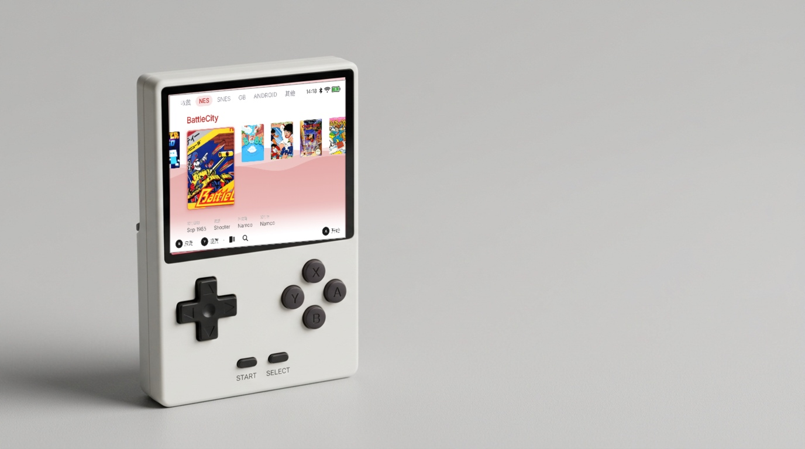
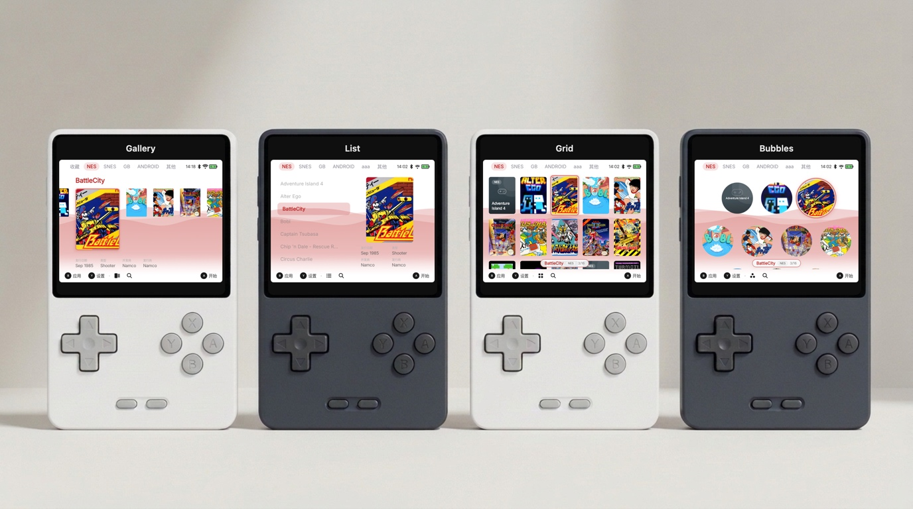
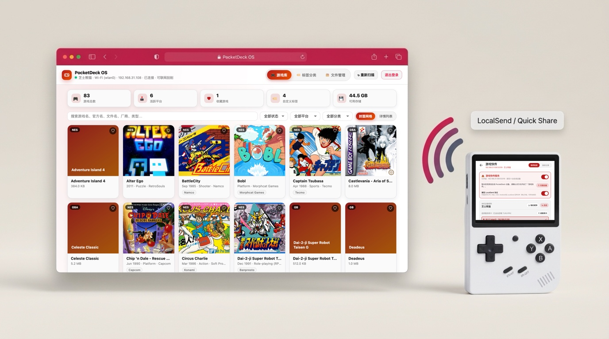

<div align="center">

# 🎮 PocketDeck

**轻量、丝滑、开源的 Android 掌机游戏启动器与无线游戏库管理前端**

[English](README.md) · [简体中文](README_ZH.md)

[-3DDC84?style=flat-square&logo=android&logoColor=white)](https://github.com/tinyc-z/PocketDeck)
[](#android-11-系统兼容)
[](https://github.com/tinyc-z/PocketDeck)
[](#游戏快传与-localsend-协议兼容)

<br/>



*专为 **KONKR Pocket Block** 等 4:3 小屏掌机与各类 16:9 Android 掌机深度打磨。*

</div>

---

## ✨ 产品亮点

PocketDeck 基于 **Jetpack Compose** 原生打造，零重型反射框架、自定义 `graphicsLayer` 零重组动画管线，带来毫秒级冷启动、丝滑跟手的掌机交互体验，以及仅约 3 MB 的轻量发布包体积。

### 🖼️ 四大视图模式 —— 榨干每一寸小屏视野

<div align="center">
  
</div>

- **Gallery（画廊）**：横向弹簧阻尼封面轮播，卡片下方实时展示发行日期、类型、开发商、发行商与文件大小。
- **List（列表）**：主机感胶囊高亮列表 + 右侧大图封面预览与双栏元数据详情。
- **Grid（网格）**：5 列高密度封面网格，采用**不占行的悬浮游戏名胶囊**（当焦点接近屏幕底部时自动切换至顶部居中，既不遮挡焦点卡片，也不压缩宝贵的网格行数）。
- **Bubbles（气泡）**：3-4-3-4 蜂窝错行圆形封面视图，配合弹性缩放与悬浮标题胶囊，在小尺寸 4:3 掌机屏幕上呈现更开阔的视野。

---

### 🌐 PocketDeck OS —— 游戏风 Web 游戏库管理后台

<div align="center">
  
</div>

只需在同一局域网下打开浏览器访问掌机地址（`http://<掌机IP>:8686`），输入掌机屏幕上的 **4 位动态密码**（内置防暴力猜测锁定与会话踢出），即可获得完整的桌面端管理控制台：

- **游戏化 UI 与实时主题同步**：告别商务灰黑面板，采用掌机 OS 游戏风格界面，并**实时跟随掌机当前的亮色 / 暗色模式与 8 种主题色**（Ruby / Ocean / Emerald / Violet / Sunset / Sakura / Cyan / Gold）动态切换。
- **封面与元数据 100% 源自掌机本身**：网页端展示的所有游戏封面与元数据均由掌机直接提供或由掌机本地缓存回传（浏览器绝不直连任何外网域名）；需要更新时可从网页端一键触发掌机联网抓取并回传展示，也支持直接从电脑上传自定义封面。
- **网页端标签分类管理（带严格安全校验）**：在网页端直接**拖拽排序**、新建与编辑自定义分类、`NOW / FAVS / OTHER` 系统标签别名及排序规则、设置显隐；保存同步至掌机时，掌机端会对 JSON 结构、长度、字符集、枚举值与引用完整性做严格校验并实时刷新掌机界面。
- **全能 Web 文件库系统**：支持面包屑导航、磁盘剩余空间统计、按名称/大小/时间/类型排序与过滤、**多选批量移动 / 复制 / 打包 ZIP / 删除**、**整个文件夹拖放或选择上传（`webkitdirectory`）**、压缩包内容预览与解压（ZIP / 7Z / RAR / TAR）、图片/音频在线预览以及配置文件在线编辑。

---

### ⚡ 游戏快传 & LocalSend 协议原生兼容

- **双协议自动发现与传输**：同时支持 **PocketDeck 原生快传**（`53318/53319`）与 **LocalSend v2**（`53317` HTTPS/TLS + UDP 组播发现），可直接与 Windows / macOS / Linux / iOS / Android 官方 LocalSend 客户端互传 ROM 与文件。
- **一键开关配置**：LocalSend 协议兼容**默认开启**，可在「游戏快传」页面或「局域网服务控制面板」随时手动开启或关闭。
- **物理网卡精准绑定**：自动屏蔽 Clash / Tailscale / WireGuard 等 TUN/VPN 虚拟网卡，支持在多网卡（双 Wi-Fi / 热点 / 有线 / USB 网卡）间自由切换。
- **固定收件箱与历史一键定位**：接收文件默认统一存入 `Download/PocketDeck` 子目录（接收前亦可按需改选目标目录），实时显示进度与速率，接收记录支持一键查看或直接跳转至文件管理目录定位。

---

### 🎨 高度可定制与强大兼容性

- **8 种主题色 & 7 种背景动效**：支持 `Waves`（流动波浪）、`Gradient`（极光渐变）、`Particles`（气泡粒子）、`Cover Blur`（封面毛玻璃）、`Static Waves`、`Custom Image`（自定义壁纸）及纯色背景。
- **自定义字体与 5 种按键音**：支持导入 `.ttf / .otf / .ttc` 字体文件，内置 5 套掌机按键音效预设。
- **多源封面与元数据刮削**：支持拖拽排序 **Libretro Thumbnails / DB**、**Hasheous（CRC32 精确匹配）**、**ArcadeItalia**、**Wikidata**、**ScreenScraper.fr**、**TheGamesDB** 与 **IGDB**。
- **40+ 独立模拟器 & RetroArch 核心支持**：内置支持 RetroArch（自动或指定核心）、PPSSPP、DuckStation、DraStic、melonDS、Dolphin、AetherSX2 / NetherSX2、Citra / Azahar、Yuzu 系列分支、Cemu、Vita3K、Flycast、mGBA、Winlator 及任意自定义 Android 应用启动协议。
- **完整手柄操作体验**：支持十字键/摇杆导航、`L1/R1` 切换标签、`Swap ABXY`（任天堂 ↔ Xbox 布局）、全快捷键自定义与冲突检测、以及作为系统桌面（Home Launcher）使用。

---

## 🛠️ 配置与使用说明

### 1. ROM 目录结构建议

在内部存储或外置 TF 卡中创建根目录（如 `/sdcard/ROMs/` 或 `/sdcard/PocketGames/roms/`），其下每个子文件夹对应一个游戏平台：

```text
ROMs/
├── nes/        # 红白机 NES（兼容别名：fc, famicom）
├── snes/       # 超级任天堂 SNES（兼容别名：sfc, superfamicom）
├── gb/         # Game Boy
├── gbc/        # Game Boy Color
├── gba/        # Game Boy Advance
├── nds/        # Nintendo DS
├── psx/        # PlayStation（兼容别名：ps1）
├── psp/        # PlayStation Portable
├── megadrive/  # 世嘉 MD（兼容别名：md）
└── arcade/     # 街机 / FBNeo / MAME
```

可在 **设置 → 游戏库** 中添加多个目录（内部存储 + 外置 TF 卡可同时启用并自动合并），也可在 **设置 → 标签页** 中将多个平台合并为自定义分类。

### 2. Android 11 系统兼容

PocketDeck 支持 **Android 8.0（API 26）至 Android 16（API 36）**，并针对 **Android 11（API 30）** 做了全面适配：
- **所有文件访问权限（`MANAGE_EXTERNAL_STORAGE`）**：在 Android 11+ 上授予文件访问权限后，即可自由扫描任意目录与外置存储卡（包含多种系统设置页兜底跳转）。
- **FileProvider 安全启动**：针对 PPSSPP、DraStic、Flycast、mGBA 等独立模拟器统一使用 `content://` FileProvider URI + `FLAG_GRANT_READ_URI_PERMISSION`，避免 Android 11+ 触发 `FileUriExposedException` 闪退。
- **包可见性声明（`<queries>`）**：在 `AndroidManifest.xml` 中完整声明常用模拟器包名、`LEANBACK_LAUNCHER` 与 `ACTION_VIEW` 协议，确保 Android 11+ 准确识别已安装的模拟器。

### 3. 快传与 Web 管理后台使用

1. 在主页按 **`B` 键** 打开「应用」→ 进入 **游戏快传 / 局域网服务**（或在游戏库顶部点击局域网按钮）。
2. 选择物理局域网网卡（如 `Wi-Fi (wlan0)`）。
3. 开启 **游戏快传**：可扫描同网段其他 PocketDeck 设备及开启了接收的 **LocalSend** 设备（可在下方开关控制 LocalSend 协议兼容）。
4. 开启 **Web 游戏管理**：在电脑/平板浏览器打开显示的 `http://<IP>:8686`，输入屏幕上的 4 位动态密码即可进入后台。

---

## 📦 编译与打包说明

### 环境要求

- **JDK 17+**（推荐直接使用 Android Studio 内置 JBR）
- **Android SDK**（`compileSdk 37`、`minSdk 26`、`targetSdk 36`）

### 构建命令

```bash
# 克隆仓库
git clone https://github.com/tinyc-z/PocketDeck.git
cd PocketDeck

# 构建 Debug 安装包
./gradlew assembleDebug

# 构建 Release 安装包（已开启 R8 代码混淆优化与资源压缩）
./gradlew assembleRelease
```

编译产物位于 `app/build/outputs/apk/`，输出文件名自动携带版本号与 Build 号：
`PocketDeck-v<versionName>-b<buildNumber>-release.apk`

### Release 签名配置

1. 复制签名模板文件：
   ```bash
   cp keystore.properties.example keystore.properties
   ```
2. 在 `keystore.properties` 中填写正式签名信息（该文件已加入 `.gitignore`，不会提交到仓库）：
   ```properties
   storeFile=release.keystore
   storePassword=你的密钥库密码
   keyAlias=pocketdeck
   keyPassword=你的私钥密码
   ```
   *（CI 环境下也支持通过环境变量 `KEYSTORE_FILE`、`KEYSTORE_PASSWORD`、`KEY_ALIAS`、`KEY_PASSWORD` 传入；本地未配置 `keystore.properties` 时会自动回退为 debug 签名以便本地测试。）*

### Build 号生成机制

`app/build.gradle.kts` 会自动生成并注入 `BuildConfig.BUILD_NUMBER`、`BuildConfig.BUILD_TIME`、`BuildConfig.GIT_HASH` 与 `BuildConfig.PROJECT_URL`（可在掌机 **设置 → 关于** 页面查看，且支持点击直接打开项目主页）：
- 优先读取 Gradle 属性或环境变量 `POCKETDECK_BUILD_NUMBER`（方便 CI/CD 注入流水号）。
- 否则自动读取 `git rev-list --count HEAD` 与短哈希，若无 `.git` 目录则自动按构建时间戳生成。

---

## 🔗 开源地址与致谢

- **GitHub 开源仓库**：[https://github.com/tinyc-z/PocketDeck](https://github.com/tinyc-z/PocketDeck)
- **协议与数据源致谢**：LocalSend Protocol v2、Libretro Thumbnails & Database、Hasheous、ArcadeItalia、Wikidata、ScreenScraper.fr、TheGamesDB、IGDB。
