# PocketDeck v0.6.0 屏幕兼容性修复与复测报告

> **测试环境**：官方 Android 模拟器（`PIXFI_API31`，Android 12 / API 31，ARM64）  
> **测试版本**：`PocketDeck-v0.6.0-b56-debug.apk`（`main` 分支）  
> **对比基线**：[v0.5.1 基线测试报告](../v0.5.1/README.md)

---

## 一、本次修复项与复测结果总览

| 编号 | 问题描述（v0.5.1） | 修复方案（v0.6.0） | 复测状态 |
| :---: | :--- | :--- | :---: |
| **P0-1** | 宽度 `< 460dp`（1:1 / 8:7 / 4:3 VGA / 9:16）时 `BottomBar` 右侧 `A Play` 文字被挤出或截断 | `BottomBar` 在 `maxWidth < 460.dp` 时隐藏 `View` 与 `Search` 文本标签，仅保留圆形图标徽章，确保 `A Play` 完整显示 | **已修复** |
| **P0-2** | 宽度 `< 460dp` 时 `Settings` 主题色行 `Color` 标签被挤掉、第 8 个颜色圆点截断 | `AccentDots` 使用 `FlowRow`，在 `screenWidthDp < 460` 时自动切换为 4×2 两行排布 | **已修复** |
| **P1** | 宽度 `< 460dp` 时 `Apps` 抽屉固定 5 列过窄导致 `Messages` 单字母换行 | `AppsScreen` 改为响应式列数（`<460dp` 用 4 列，常规 5 列，`>=900dp` 用 6 列），并同步 DPAD 上下导航步长 | **已修复** |
| **P2-1** | 8.8 寸平板（`1280×800 dp`）`Gallery` 卡片固定 `182dp` 偏左上、右下方大面积留白 | `HomeScreen` 按 `screenHeightDp * 0.42f`（并受限于宽度上限，区间 `182dp..320dp`）动态缩放画廊主卡与副卡高度 | **已修复** |
| **P2-2** | 矮屏（`320dp` 高）`GameMenu` 仅展示 2.5 项、`Edit` 被裁半 | `GameMenu` 在 `screenHeightDp <= 360` 时收紧弹窗内间距与按钮垂直 padding | **已修复** |
| **P1-2** | 窄屏（`< 500dp`，如 1:1 / 9:16）下游戏中心顶栏 `Game Library` 被 `LAN & Share` 与切换胶囊挤压折成 3 行裁切 | `LibraryToolbar` 在窄屏下收紧左右边距、隐藏装饰小图标并限制标题单行省略，确保顶栏清爽完整 | **已修复** |

---

## 二、重点屏幕规格复测截图验证

### 1. 1:1 方形屏（`720×720` @ 280dpi，`411×411 dp`）

- **BottomBar**：`View` 与 `Search` 仅显示图标，右下角 **`A Play` 完整呈现**。
- **Settings**：`Color` 标签恢复完整显示，8 个主题色以 **4×2 网格**整齐排布无截断。
- **Apps**：自适应切换为 **4 列**，`Quick Share` 与 `Messages` 均单行完整显示。

| 1:1 画廊（BottomBar 修复） | 1:1 设置（4×2 主题色） | 1:1 应用抽屉（4 列布局） |
| :---: | :---: | :---: |
| 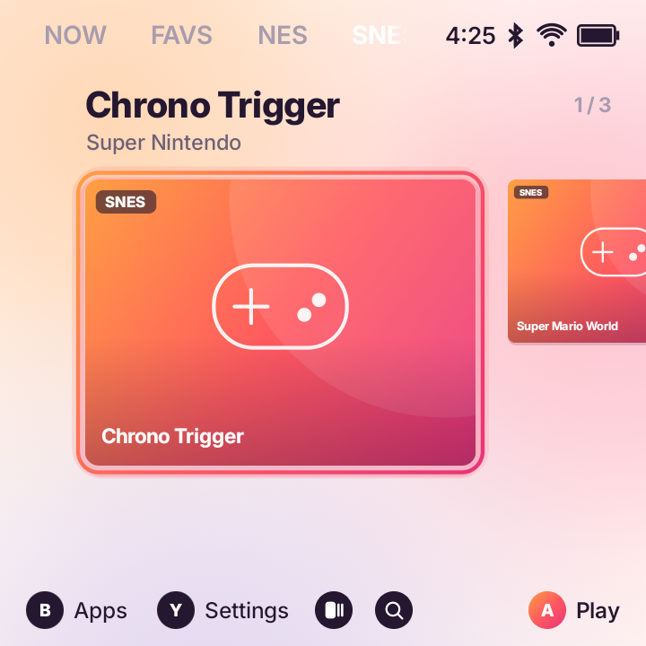 | 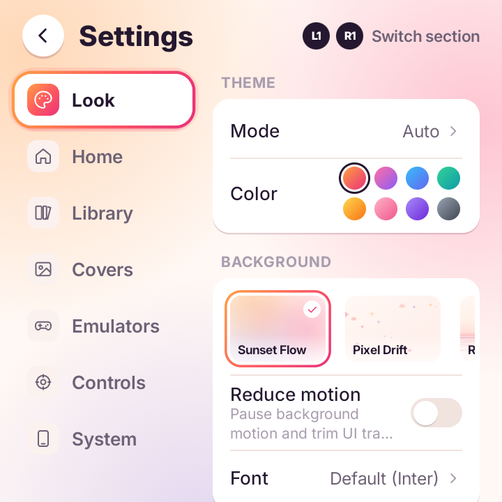 | 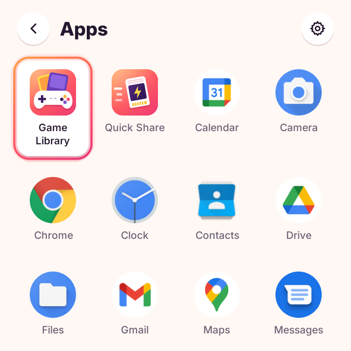 |

---

### 2. 4:3 极小 VGA（`640×480` @ 240dpi，`427×320 dp`）

- **BottomBar**：`A Play` 完整显示，不再截断为 `A P`。
- **GameMenu**：`320dp` 高度下 `Play`、`Favorite`、`Details` 与 `Cancel` 全部完整居中展示，无半行裁切。

| 4:3 VGA 画廊 | 4:3 VGA 游戏菜单（紧凑间距） |
| :---: | :---: |
| 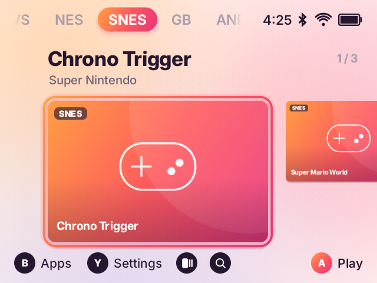 |  |

---

### 3. 8:7 准方竖屏（`1080×1240`）& 9:16 竖屏（`1080×1920`）

- `BottomBar` 在 `432dp`（Pocket DMG）与 `411dp`（竖屏）下均完整展示 `A Play`；9:16 竖屏下画廊卡片也按可用宽度比例适度放大，不再局限于左上角小卡片。

| 8:7 准方竖屏画廊 | 9:16 竖屏画廊 |
| :---: | :---: |
| 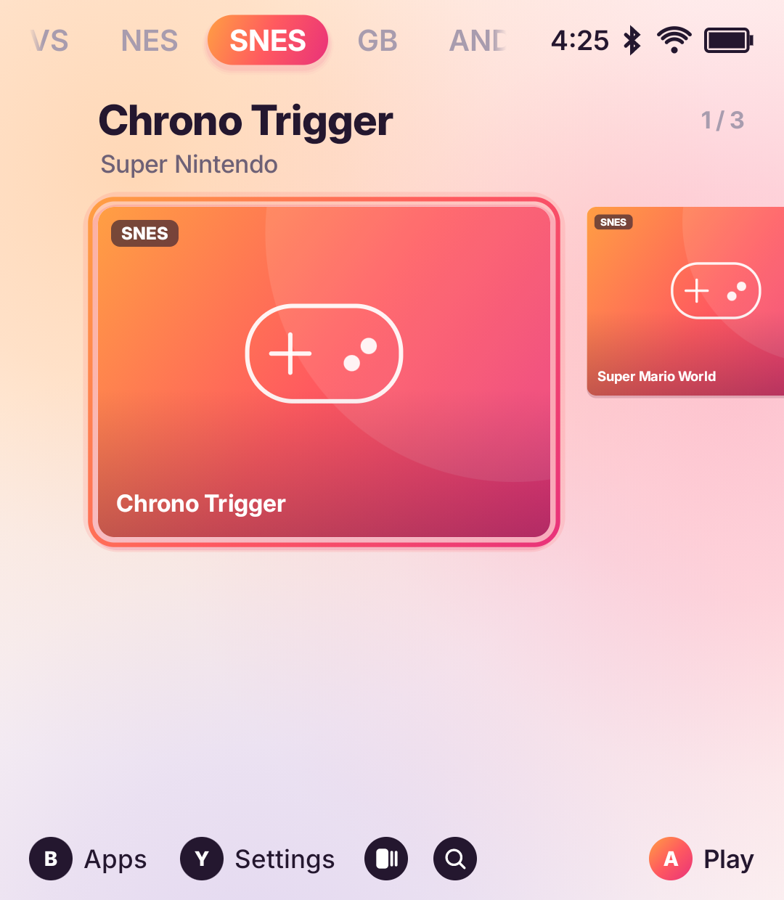 |  |

---

### 4. 8.8 寸平板大屏（`2560×1600`）& 16:9 主流横屏回归（`1920×1080`）

- **8.8 寸平板 (`1280×800 dp`)**：画廊主卡放大至 `320dp` 高、副卡同步等比放大，视觉比例饱满协调。
- **16:9 主流横屏 (`768×432 dp`)**：回归验证完全保持原设计比例（`View` 与 `Search` 正常带文字、卡片 `182dp`），无任何副作用。

| 8.8 寸平板画廊（比例放大） | 16:9 主流横屏回归 |
| :---: | :---: |
| 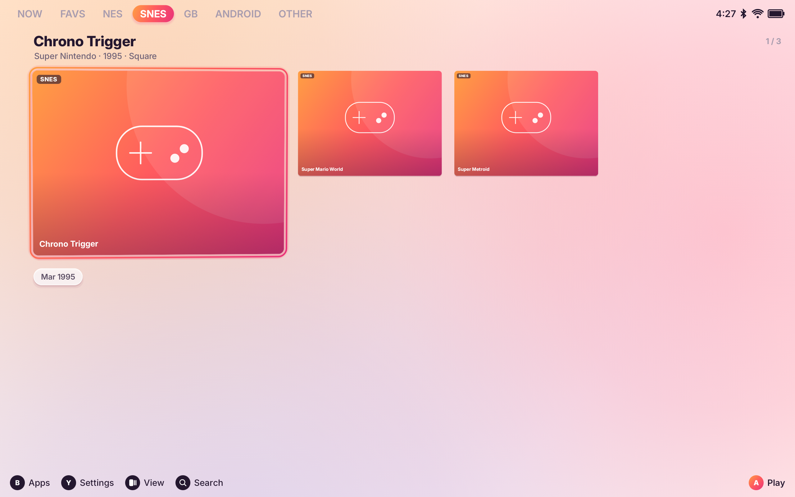 | 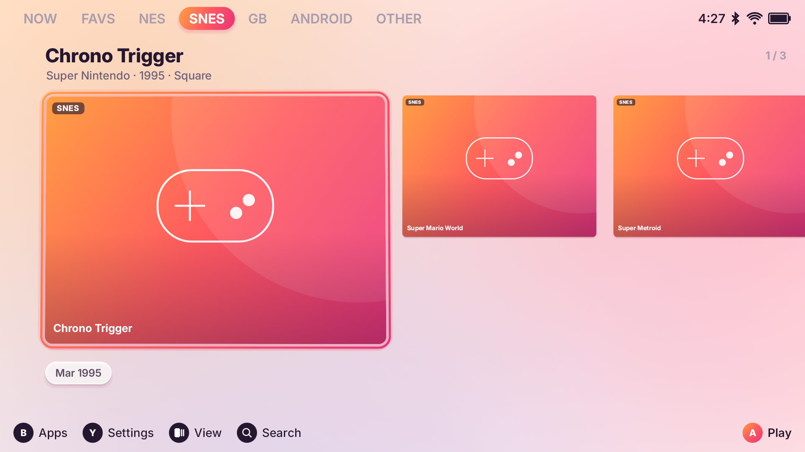 |

---

### 5. 游戏中心（Game Library）与文件管理器（Files）全尺寸实测

- **游戏中心（Games 模式）**：修复前在 `411dp` 窄屏下顶栏标题折行裁切为 `Game / Librar / y`；修复后顶栏 `Game Library` + `13 games · 0 hidden`、`LAN & Share` 与 `Games | Files` 切换胶囊在 **1:1 / 4:3 VGA / 9:16 / 16:9 / 平板** 下均单行完整，筛选胶囊支持横向滚动。
- **文件管理器（Files 模式）**：路径面包屑（`~/ROMs`）、工具栏（`搜索 / Storage / New folder / Select`）与目录列表（`.. Up / gba / nds / psp / psx / snes`）在各尺寸下均单行对齐，无任何溢出或遮挡。

| 1:1 游戏中心（顶栏修复后） | 1:1 文件管理器 |
| :---: | :---: |
| 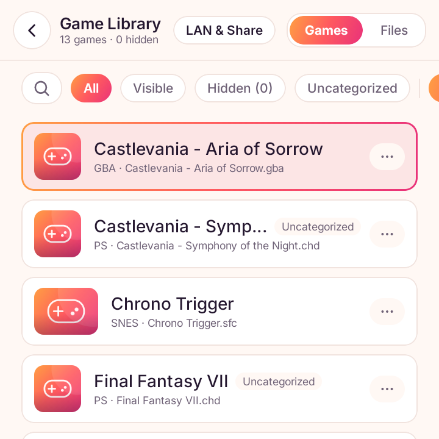 | 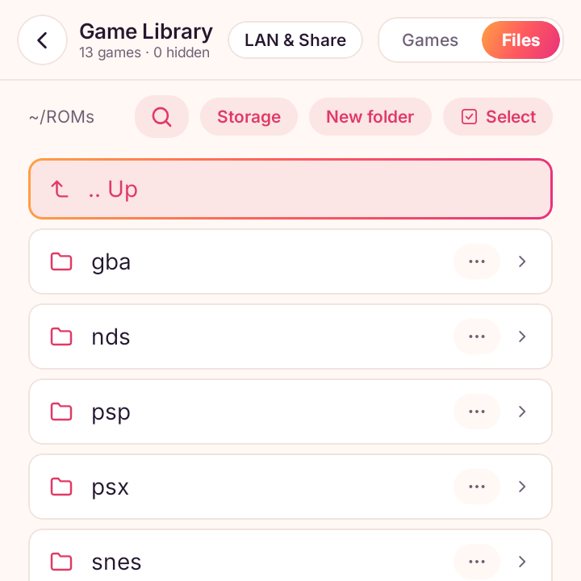 |

| 4:3 VGA 文件管理器（`427×320 dp`） | 9:16 竖屏文件管理器（`411×731 dp`） |
| :---: | :---: |
| 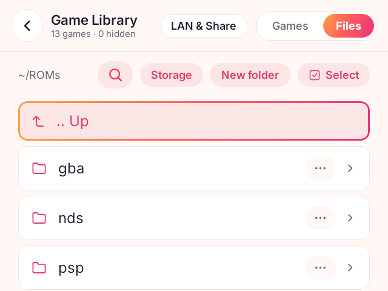 | 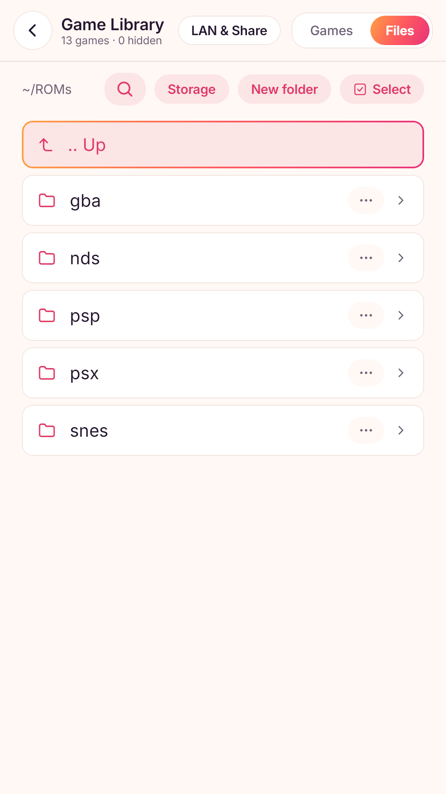 |

| 16:9 主流横屏文件管理器 | 8.8 寸平板文件管理器 |
| :---: | :---: |
| 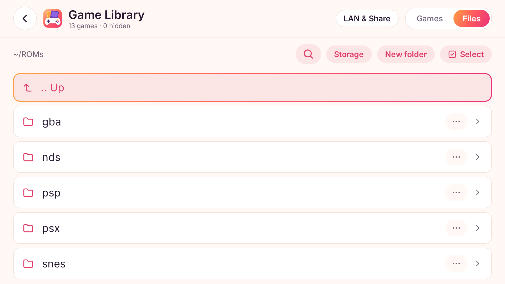 | 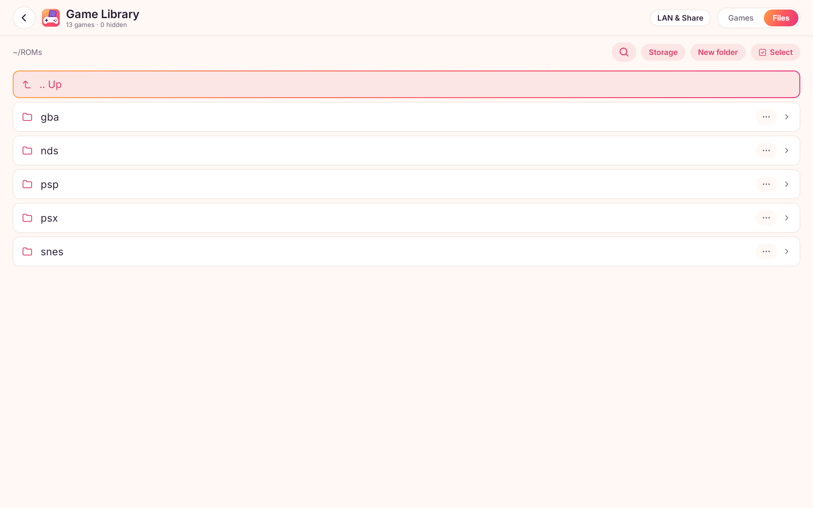 |

---

### 6. 桌面游戏详情页替代右键菜单（`X` 键 / 长按直达）

- 桌面按 `X` / 长按现已直接打开升级后的 `GameDetailDialog`：
  - 新增 **所属分类胶囊** 与 **当前模拟器徽章**，保留游玩统计与简介，并支持多盘游戏内联选盘。
  - 底部精简为 **`Play / [Discs] / Favorite / Edit / Properties`**。
  - 横屏（`>= 480dp`）采用左封面 + 右信息 + 单行操作栏；窄屏（`< 480dp`，如 `4:3 VGA` 与 `1:1` 方屏）自动切为上下分块 + 底部主按钮独占行，在 `427×320 dp` 极限小屏下无任何裁切。

| 16:9 横屏详情页 | 4:3 HD 详情页（`960×720`） | 4:3 VGA 详情页（`640×480`） | 1:1 方屏详情页（`720×720`） |
| :---: | :---: | :---: | :---: |
| 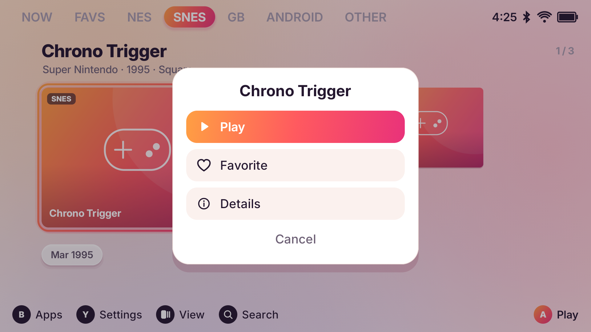 | 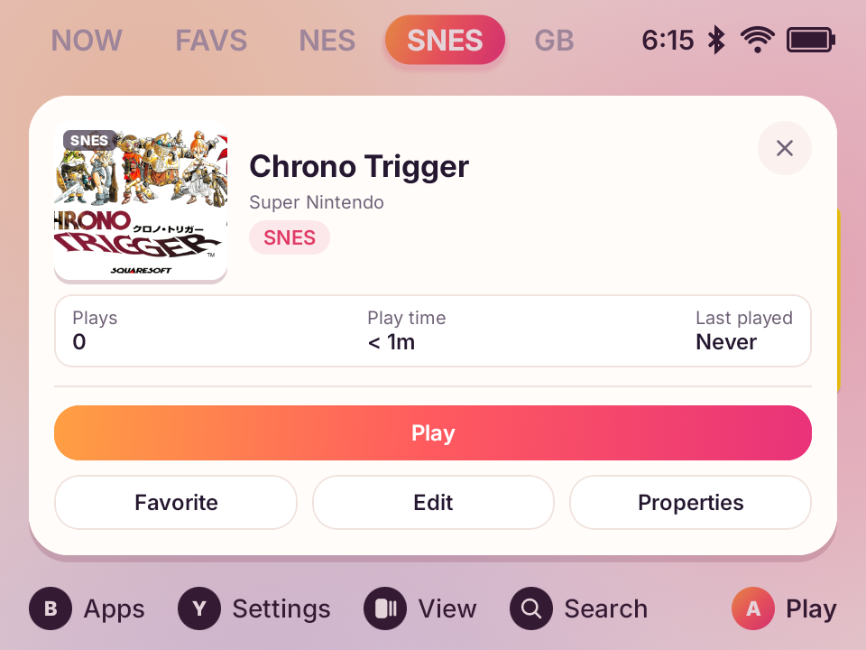 |  | 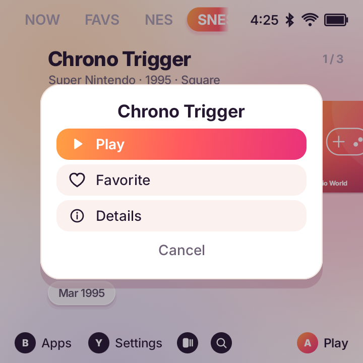 |

| 960×720 游戏中心 | 960×720 文件管理器 |
| :---: | :---: |
| 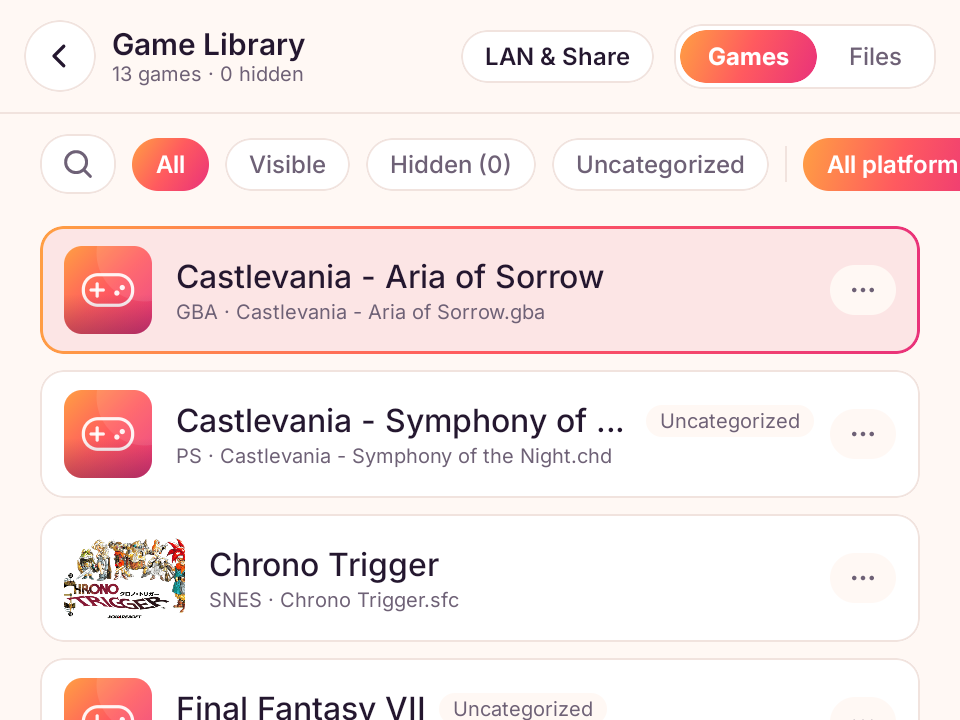 | 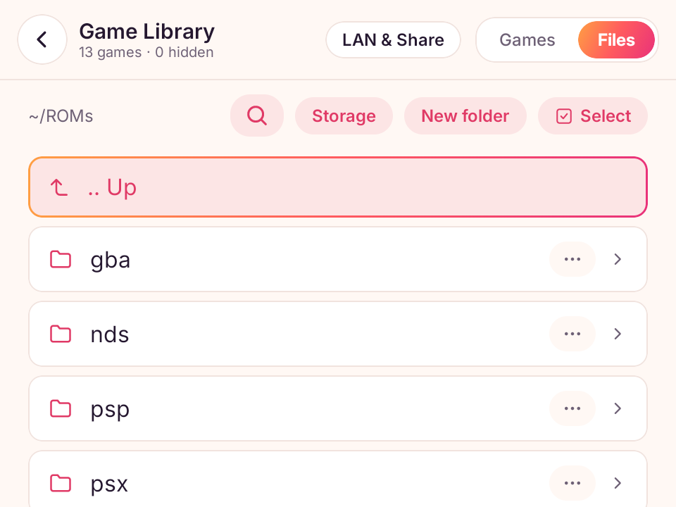 |
